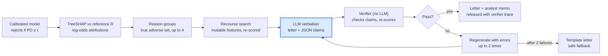

# REFERENCE — Faithful Credit Reasons

Exported from the live reference doc; regenerate this file whenever the doc changes. Last export: 2026-11-27 (C8).

## 0. How to use this document

This is the single source of truth for Project 3. Read Sections 1–3 once before writing code; they hold the thesis and the contract everything else serves. Sections 4–8 are the technical specification. Section 10 is the commit plan, worked through linearly. Sections 12–14 are for shipping and interviewing. Amend this document whenever reality diverges from it, including when something did not work.

There is no deadline. Phases are ordered by dependency, not calendar; a phase is done when its exit criteria are met.

**Repository name:** `faithful_credit_reasons`. It states the thesis in three words and reads well as a resume link. The Python package inside it is fcr.

### 0.1 Working method: git + Kaggle

**Decision: code lives in git from commit 1, as a tested Python package. Kaggle notebooks are thin drivers that install that package at a pinned commit and run the heavy jobs.** Notebooks are committed into `notebooks/` as each phase finishes, not dumped at the end.

Why not run everything in notebooks and upload at the end:

- Commit history is part of the portfolio. Interviewers who open the repo see how the work was built; one end-of-project notebook dump erases that signal.
- Notebook logic cannot be imported. The explanation layer (Section 6) must call the exact feature pipeline and model that the ML layer trained; a shared package guarantees that, copy-pasted cells do not.
- Notebooks resist tests and clean diffs, and Project 2's commit-plus-smoke workflow already works for you.

How the two halves connect:

1. Every commit is a logical unit with `pytest` passing on your MacBook. Tests use **synthetic fixtures generated in code** that mimic the competition schema, so a clean clone tests without the data.
2. Data-heavy smoke runs happen on Kaggle. A driver notebook clones the repo, checks out the pinned commit, installs the pinned lock (requirements.txt, so Kaggle runs the same versions as the Mac), then runs `pip install -e`, executes `scripts/smoke_cNN.py`, and you paste the output back (exact cell in `notebooks/README.md`). Pinning the SHA makes every Kaggle run traceable to a commit. A plain `pip install git+…` was the first plan, but it copies only the package, so `configs/` and `scripts/` would be missing. Kaggle notebooks need **Internet: On** in settings, which requires a phone-verified account.
3. Heavy artifacts (feature parquet, trained models, attribution tables) are saved as **private Kaggle Datasets**, versioned, and attached to later notebooks. Only small derived results (metrics JSON, figures, tables) go into git.
4. For local iteration, a Kaggle script exports a **stratified sample of about 50k cases** as parquet that you download into a gitignored `data/` folder.
5. Raw competition data never enters git. Competition data is typically licensed for competition use; check the rules page before publishing any derived dataset.

The per-commit delivery stays as in Project 2: changed files as a zip with repo-relative paths, the full command set, you run tests and smoke and paste output back, and this document is amended after every commit.

## 1. Thesis

### 1.1 The one-sentence version

Lenders must tell rejected applicants reasons that accurately describe the factors their model actually scored, and banks now want LLMs to write those reasons; this project builds an out-of-time-validated credit default model on Home Credit's 2024 stability benchmark plus an LLM reason-writing layer, and **uses the model itself as ground truth** to measure whether LLM-written explanations are faithful — then shows which design choices, in the model and in the generation pipeline, make them so.

### 1.2 Why the obvious version is not worth building

"Home Credit + LightGBM + SHAP plots" is one of the most common credit portfolio projects on Kaggle. "An LLM turns SHAP values into plain English" also already exists as published work (Explingo, XAIStories; Section 2.3). Building either again is a competent tutorial, not a differentiator.

### 1.3 What is actually unsolved

Prior LLM-narrative work grades narratives with another LLM, checking the text against the SHAP table. Two gaps remain:

- **Nobody checks the claims against the model.** A narrative can match the SHAP table and still give recourse advice ("lowering your debt by X would get you approved") that is false when you re-score the model. Only the model can verify that.
- **Fluency hides unfaithfulness.** Users find LLM narratives convincing whether or not they are right (Section 2.3). In credit, a convincing wrong reason is a compliance failure, not a style issue.

Credit adds constraints general XAI work ignores: masked or hashed features that cannot be named to a customer, protected attributes that must never appear as a reason, and the choice of reference population, which silently changes which reasons come out.

### 1.4 The three claims this project will make

1. **Ungrounded LLM explanations of credit decisions are fluent but measurably unfaithful.** They produce sign errors, fabricated factors and invalid recourse, and an LLM grader under-detects these relative to model-in-the-loop verification. *(Measured: faithfulness metrics, Section 7; grader-vs-verifier agreement.)*
2. **Structured grounding plus deterministic verification makes explanations faithful at a small readability cost.** *(Measured: conditions E0–E3.)*
3. **Explanation quality depends on ML design choices upstream.** Monotone constraints and the reference population change reason stability and recourse validity, at a measurable AUC cost. *(Measured: ablations M1–M3, Section 7.4.)*

Claim 3 is what makes this an ML-plus-GenAI project rather than an LLM bolted onto a Kaggle model: the explanation layer's quality is shown to depend on decisions made in the model.

## 2. Why banks care, and where this sits

The US rule for rejection reasons is, in effect, a faithfulness requirement: reasons must match what the model actually scored. India's regulator is moving toward lifecycle model-risk rules that explicitly cover AI/ML. Both make "is this explanation true to the model?" a governance question, which is exactly what this project measures.

### 2.1 Regulatory anchors

| Source | Jurisdiction | What it says | What it means here |
| --- | --- | --- | --- |
| [Regulation B commentary, §1002.9(b)(2)](https://www.consumerfinance.gov/rules-policy/regulations/1002/2023-08-29/interp-9/) | US | Specific reasons must relate to and accurately describe the factors actually considered or scored by the creditor | The faithfulness contract (Section 3) operationalises this sentence |
| [Regulation B commentary (2026-06-30 version)](https://www.consumerfinance.gov/rules-policy/regulations/1002/2026-06-30/interp-9/) | US | No fixed number of reasons is mandated, but more than four is unlikely to help the applicant | Letters carry at most 4 principal reasons |
| [CFPB Circular 2022-03](https://www.consumerfinance.gov/compliance/circulars/circular-2022-03-adverse-action-notification-requirements-in-connection-with-credit-decisions-based-on-complex-algorithms) | US | Complex algorithms do not excuse a creditor from giving specific, accurate reasons | Motivates using a complex model *and* proving its reasons are accurate. Check the circular's current status before citing it in interviews |
| [RBI FREE-AI Committee Report](https://www.rbi.org.in/scriptS/PublicationReportDetails.aspx?ID=1306) (13 Aug 2025) | India | 7 sutras and 26 recommendations; sutras include Understandable by Design, Accountability, Fairness and Equity | Interview framing for Indian banks: "aligned with", never "compliant with" |
| [RBI draft Guidance on Model Risk Management](https://www.rbi.org.in/SCRIPTs/BS_PressReleaseDisplay.aspx?prid=63006) (24 Jun 2026) | India | Lifecycle model-risk principles covering validation, monitoring and change management, including third-party and AI/ML models; comments closed 24 Jul 2026 | The model card and monitoring in Section 5 mirror these lifecycle stages. Check whether it has been finalised |

Open question: whether RBI's Fair Practices Code requires lenders to give rejection reasons in writing. Verify the current text before using it as an Indian analogue to Regulation B.

### 2.2 What a bank interviewer recognises

- **Out-of-time validation and drift**, the way model validation teams test credit models.
- **Monotone constraints and reason codes**, the language of scorecard practitioners.
- **Calibrated probability of default (PD)**, because PDs feed pricing and provisioning, not just ranking.
- **A model card with limitations**, the artifact a model-risk reviewer asks for first.
- **Faithful customer communication**, the exact worry that blocks GenAI deployment in regulated lending.

### 2.3 Prior work and the gap

| Work | What it did | Gap this project fills |
| --- | --- | --- |
| [Explingo](https://arxiv.org/abs/2412.05145) (Zytek et al., IEEE BigData 2024) | An LLM Narrator turns SHAP explanations into narratives; an LLM Grader scores accuracy, completeness, fluency and conciseness | Grading is LLM-on-text. We verify every claim against the model, including re-scoring for recourse, and test whether an LLM grader misses errors |
| [XAIStories (Martens et al., 2025), as summarised here](https://arxiv.org/pdf/2605.23867) | Users found SHAP and counterfactual narratives more convincing than raw explanations in 93% and 90% of cases | Convincing is not correct; we measure persuasive-but-unfaithful output directly (condition E0) |
| [FinRegLab / Stanford GSB white paper](https://finreglab.org/wp-content/uploads/2023/07/FRL-ML-EWP_July2023.pdf) (Jul 2023) | Compared explainability tools on whether they gave consistent answers to the same question about the same underwriting model, including for adverse action | We extend the consistency question to the LLM layer and to upstream modelling choices (claim 3) |

Also relevant: the counterfactual and recourse literature (Wachter et al. 2017; Ustun et al. 2019; DiCE, Mothilal et al. 2020) and the Shapley-baseline literature (Sundararajan & Najmi 2020), listed in Section 14. MIT's write-up of Explingo notes that adding more style guidelines to the narrator made it more likely to introduce errors ([MIT News](https://alumcommunity.mit.edu/news/1086934)). That is a direct motivation for letting the LLM only verbalise, never decide, in condition E2.

## 3. The faithfulness contract

**An explanation is faithful if and only if every checkable claim in it is true of the model, and the checks are run by code against the model, not by an LLM reading the text.** This is the analogue of Project 2's agency contract: it is falsifiable, it is decided before any results exist, and the project can fail it.

### 3.1 Objects

For applicant *i* the system holds:

- the trained model *f*, its calibrated PD *p(x)*, and the decision threshold *τ* (reject if *p ≥ τ*);
- the TreeSHAP attribution vector *φᵢ* in log-odds space, computed against a stated reference population *R* (Section 6.1);
- a **reason-group map** *G* that bundles raw features into human concepts (for example, all days-past-due features into "recent missed payments"). A group's attribution is the sum of its members' attributions;
- the **true adverse set**: the top *k ≤ 4* groups with positive attribution (pushing toward default), ranked by size.

The true adverse set is computed deterministically. It is the ground truth every generated explanation is scored against.

### 3.2 Claim types and how each is verified

| Claim type | Example in a letter | Verified by | Passes when |
| --- | --- | --- | --- |
| Factor | "Your recent missed payments affected the decision" | Lookup in the true adverse set | The group is in the set |
| Direction | "Your outstanding debt is too high" | Sign of the instance's attribution, plus a local check that moving the feature that way lowers *p(x)* | Both agree with the stated direction |
| Rank | "The main reason was…" | Position in the true adverse set | The group is ranked 1 |
| Recourse | "Reducing outstanding debt below X would likely change the outcome" | **Re-scoring the model** with that one change | New *p < τ*, and the change is feasible (Section 6.4) |
| Quantity | "You missed 3 payments" | The applicant's actual feature values | The number matches the input |
| Prohibited | Any mention of age, sex, family status or disability-related income type | Lexicon plus structured-output check | Never present |

Claims come out of the LLM as structured JSON (claim type, reason-group ID, direction, value) alongside the prose. For conditions where the LLM writes free text (E0, E1), a separate extractor turns prose into the same JSON, and its extraction accuracy is itself spot-checked by hand.

### 3.3 Named failure modes

1. **Omission**: a true top reason is missing from the letter.
2. **Fabrication**: a factor appears that is not in the adverse set, or not in the model at all.
3. **Sign error**: the direction is backwards ("too low" when higher values raise risk).
4. **Rank inflation**: a minor factor is presented as the main reason.
5. **Invalid recourse**: the suggested change does not flip the decision when the model is re-scored.
6. **Infeasible recourse**: the suggestion requires changing something immutable or unrealistic (age, past delinquency).
7. **Prohibited attribute**: a protected characteristic appears as a reason.
8. **Invented specificity**: a number or date that is not in the input.
9. **Masked-feature confabulation**: the LLM gives a hashed category a made-up meaning (Section 4.3).

### 3.4 Two levels of faithfulness, stated honestly

Factor, direction and rank claims are faithful **to the attribution**. TreeSHAP's attributions sum exactly to the model's output, but their meaning depends on the reference population, so this level is only as good as that choice. Recourse claims are faithful **to the model's behaviour**: re-scoring needs no attribution method at all. Keeping the two levels separate is what lets the project say which errors come from the LLM and which come from the explanation method.

### 3.5 What would falsify the claims

- If the ungrounded condition E0 already meets the faithfulness bar (Section 7.3), claim 1 fails, and we report it.
- If an LLM grader agrees with the deterministic verifier at Cohen's κ ≥ 0.8, the "graders under-detect errors" part of claim 1 fails, and we report it.
- If monotone constraints and the reference population change neither reason stability nor recourse validity, claim 3 fails, and we report it.

## 4. Dataset analysis: Home Credit – Credit Risk Model Stability

**The training base holds 1,526,659 applications with a 3.14% default rate, decided between January 2019 and October 2020 across 92 weekly buckets (WEEK\_NUM 0–91).** Features are spread over roughly 30 training tables at three depths. The competition's hidden test set is not available, so every reported number comes from an out-of-time split we cut from the training weeks. Figures below are from a public ETL write-up ([Zheng, 2024](https://jzheng1995.github.io/homecredit/01-home-credit-etl)) and competition summaries; C4 re-derives every one of them from the raw files.

### 4.1 Structure

- **Depth 0**: one row per `case_id` (static application and credit-bureau summary data).
- **Depth 1**: many rows per `case_id`, indexed by `num_group1` (previous applications, bureau contracts, related persons).
- **Depth 2**: indexed by `num_group1` and `num_group2` (for example, payment histories within each previous contract). Depth 1 and 2 must be aggregated to case level ([Plaksha project summary](https://ai3011.plaksha.edu.in/Spring%202024/PDFs/Krishna%20Sharma.pdf)).
- Files follow `{split}_{family}_{depth}[_{chunk}]`. Some families are **split by rows** across numbered chunks (`credit_bureau_a_2_0` … `_10`) that share columns and must be concatenated. The digit after the family name is the depth, so `person_1` and `person_2` are a depth-1 and a depth-2 table, not column splits (corrected in C1; the ETL write-up misread this). `fcr.data.naming` encodes the convention and fails loudly on any name that breaks it.
- A `feature_definitions.csv` file maps every column to a text description. It is the raw material for the reason-group map (Section 6.2).

| Table family | Depth | Content | Role in this project |
| --- | --- | --- | --- |
| `base` | 0 | `case_id`, `date_decision`, `MONTH`, `WEEK_NUM`, `target` | Labels and the time axis for splits |
| `static_0_*` | 0 | Internal application data | Core features |
| `static_cb_0` | 0 | Credit-bureau summary | Core features; some columns almost entirely missing |
| `applprev_1_*`, `applprev_2` | 1, 2 | Previous applications with this lender | Behavioural history |
| `person_1`, `person_2` | 1, 2 | Applicant and related persons | Contains protected attributes (Section 4.4) |
| `credit_bureau_a_1_*`, `_a_2_*` | 1, 2 | External bureau contracts and payment history | Largest tables; heaviest aggregation |
| `credit_bureau_b_1`, `_b_2` | 1, 2 | Second bureau source | Behavioural history |
| `debitcard_1`, `deposit_1`, `other_1` | 1 | Account relationships | Minor features |
| `tax_registry_a/b/c_1` | 1 | Tax-registry records | Income-verification signals |

### 4.2 Column-name suffixes are transformation codes

The last letter of each column name tells you how the raw value was transformed ([Plaksha project summary](https://ai3011.plaksha.edu.in/Spring%202024/PDFs/Krishna%20Sharma.pdf)):

| Suffix | Meaning | Handling |
| --- | --- | --- |
| P | Days-past-due transform | Numeric; aggregate max/mean/last |
| A | Amount transform | Numeric; ratios to income or credit amount |
| D | Date | Convert to days before `date_decision`; never use raw dates |
| M | Masked categorical (hashed values) | Encode as categorical; **cannot be named to a customer** |
| T, L | Unspecified transforms | Inspect individually |

### 4.3 Data facts that shape the design

- **Imbalance:** 47,994 defaults out of 1,526,659 (3.14%), verified in C3. PR-AUC and calibration matter as much as ROC-AUC.
- **Missing values are nulls.** C4 counted zero empty strings in the parquet files; the ETL write-up's "(Empty string)" was an artefact of its CSV import. Of 464 feature columns, 62 are more than 95% missing (screened out), 140 are 50–95% missing and 173 under 10% (row level).
- **Masked placeholder:** `a55475b1` is the most frequent value in 53 of 63 masked columns, with a median share of 82%. No real category behaves like that, so it is read as null (`features.masked_missing_values` in the config). Masked values still can never be named to a customer, which is why failure mode 9 exists.
- **Dates:** all 57 date columns are ISO strings and all parse. Extremes include 1900-01-01, 1900-01-15 and 2098-01-15 (bureau contract end dates), which look like sentinels; C5 counts them before treating them as missing. 38 of 57 date columns hold values after the last decision date: some are scheduled dates (contract end, maturity) that may lie in the future, others are event dates (approval, creation, activation, last payment) that must not.
- **Target definition:** at least one unpaid payment within a set period, with day and amount tolerances (per the organisers' forum answer quoted in the ETL write-up). We do not know the exact window, which goes in the model card's limitations.
- **Metric gaming:** competitors gamed the official stability metric's slope term by adjusting test scores ([W&B write-up](https://wandb.ai/byyoung3/ml-news/reports/My-First-Kaggle-Challenge-Lessons-Learned--Vmlldzo3MDY0MTU3)). We report mean weekly Gini, its slope and residual spread as separate numbers, and never post-process scores by week.

### 4.4 Protected and sensitive attributes

C4 searched every column's name, definition and category values. It found 12 columns that carry a protected attribute: two sex columns (`sex_738L`, `gender_992L`, values F and M), five birth dates (`birth_259D`, `birthdate_87D`, `birthdate_574D`, `dateofbirth_337D`, `dateofbirth_342D`) and five family or marital status columns (`familystate_447L`, `familystate_726L`, `maritalst_703L`, and the masked `maritalst_385M`, `maritalst_893M`). Income type `incometype_1044T` was found only through its values `HANDICAPPED`, `HANDICAPPED_2` and `HANDICAPPED_3`, a disability proxy. One match, `equalitydataagreement_891L`, flags a change in socio-demographic data; it was reviewed and is not a protected attribute.

**Decision:** the 12 are excluded from the model's features and kept *only* for slice analysis. Income type stays a feature, because salaried, pensioner and self-employed carry real repayment information, but its disability codes are recoded to OTHER in the model matrix. None can ever appear as a reason (failure mode 7). The lists live in `configs/config.yaml`, and a test fails if a future EDA run flags a column that no list covers. Dropping a column does not remove proxies ("retired pensioner" carries age), which is why the slice analysis exists. Ablation M4 reports the AUC cost of exclusion.

**Proxies (C6).** Ten address columns are excluded as well: district and ZIP code of the current, contact, employer, registered and previous addresses (full list in `protected.proxy_columns`). Location is the textbook proxy for protected groups (redlining), and "your district" could never be given to a customer as a reason anyway. The columns are masked, so their predictive value cannot be inspected; ablation M4 measures the cost of excluding them together with the protected columns. The feature registry records each exclusion as `excluded:protected` or `excluded:proxy`, and a test fails if any feature built from either list reaches the model matrix.

### 4.5 Out-of-time split

| Split | WEEK\_NUM | Decision dates | Applications | Defaults (rate) | Used for |
| --- | --- | --- | --- | --- | --- |
| Train | 0–63 | 1 Jan 2019 – 23 Mar 2020 | 1,282,082 | 42,524 (3.32%) | Fitting models |
| Validation | 64–77 | 24 Mar – 29 Jun 2020 | 92,870 | 2,255 (2.43%) | Early stopping, calibration, choosing τ |
| Test | 78–91 | 30 Jun – 5 Oct 2020 | 151,707 | 3,215 (2.12%) | Reported numbers; touched once |

Measured in C4; boundary dates are each week's first decision date. The WHO's pandemic declaration (11 Mar 2020) falls in week 63, the last training week, so the model is fitted entirely on pre-pandemic applications and validated and tested entirely on pandemic-era ones. That is a hard but realistic test. The cost is a small validation set: 2,255 defaults, with weekly volume down to 825 in week 68. Decision (C7): keep this boundary. Calibration and the threshold are then chosen on the same pandemic-era population the test set measures, which is the question a bank deploying a model actually faces; the cost is the small validation set, which the bootstrap intervals in Section 7.5 carry. The split is frozen in configs/split\_lock.json before any model is trained: week ranges, case and default counts, and a fingerprint of each split's case ids. Every load of the feature table checks it, so a changed config or a rebuilt table cannot move cases between splits.

### 4.6 Compute

C3 and C4 measured the scale: 17 families and 464 feature columns, with `credit_bureau_a_2` alone at 188.3M rows. Building the schema registry peaked at 16.5 GB of Kaggle's 31.3 GB. No case's rows span two chunk files in any chunked family, so C5 aggregates chunk by chunk and concatenates the results, which is exact. All raw-to-feature work runs on Kaggle with Polars lazy frames; the case-level feature table is saved as a private Kaggle Dataset and as a 50k-case sample for local work.

### 4.7 What changes over time

C4 found three kinds of drift; the figures are in `results/c04/figures/`.

- **Default rate.** It rises from 2.79% (Jan–Jun 2019) to 3.30% (Jul–Dec 2019) and 4.44% (Jan–mid Mar 2020), then drops to 2.61% in the first pandemic weeks and 2.12% in test. Calibration is therefore fitted on validation weeks, never on train. The data cannot say why the rate fell (tighter approvals, payment moratoria and a shorter observation window are all candidates); the model card says so.
- **Volume.** Weekly applications fell from 15–18k in early 2020 to 825 in week 68 (late April) and recovered to 12–18k by September.
- **Which tables exist for an applicant.** The three tax registries are one source supplied in turn by three providers: c covers Jan–Sep 2019, a covers Aug 2019–Apr 2020, b covers Apr 2020 onwards. Train has almost no registry b data and test has only b, so modelled separately their features would encode time rather than risk. C6 therefore harmonises them into one set (amount, date, employer). Bureau coverage also rises, from 55% in Jan 2019 to over 95%; `static_cb_0` goes from 69% to 100%; `person_2` falls from 100% to 46% by Oct 2020; and `other_1` appears only in 2020. These feed the PSI monitoring in Section 5.4 and are expected to surface as reason drift.

## 5. ML layer

**Three models are built on the same features: a logistic-regression scorecard (the industry benchmark), an unconstrained LightGBM, and a LightGBM with monotone constraints.** All three are calibrated, judged out-of-time, and documented in a model card. The goal is not to win the leaderboard; it is a model a validation team would accept, which the explanation layer can then be tested against.

For scale: one public student project reported test ROC-AUC of about 0.78 with LightGBM on this data ([Erdős Institute slides](https://erdosinstitute.org/_files/ugd/cfa4f1_d40a575c4123496087d3aa78018431c6.pdf)). Treat that as a sanity range, not a target.

### 5.1 Feature engineering

1. **Concatenate and aggregate per chunk.** Chunk files of a family are concatenated lazily; heavy families are aggregated one chunk at a time, which is exact because no case spans two chunks (C4).
2. **Clean first.** Read `a55475b1` as null in masked columns and treat sentinel dates (before 1901, or 2090 and later) as missing. C5 found 950 sentinel values in bureau contract dates and 3 in a birth date. Disability-coded income types are recoded in C6.
3. **Leakage control by date role** (`configs/date_roles.yaml`). Every date column has exactly one role. *Event* dates (the default) record something that already happened; a value after the case's own `date_decision` is set to null. *Scheduled* dates (contract end, maturity, first due date) may lie in the future and are kept. *Retrieval* timestamps record when the lender pulled data from a provider while processing the application, typically days after `date_decision`; they are dropped and never used. *Anchors* date a record's creation; a record whose anchor is after `date_decision` is dropped whole. Every date becomes days before `date_decision`. A test, and the real-data smoke run, assert that no event-date feature is negative. The retrieval role was added in C5.1, after the first real build showed bureau response dates almost entirely after the decision and an anchor on such a timestamp dropping half the tax registry. C5.1's lag profile then showed that every event-date column's post-decision values fall within 30 days of the decision, so the data snapshot was taken up to about a month after each application. Nulling those values is right, but pre-aggregated static\_0 fields (for example last-payment or days-past-due summaries) may already include up to a month of post-decision activity and cannot be cleaned row by row. This residual leakage risk is probed in C9 (train with and without the suspect static\_0 summaries and compare validation AUC and attribution), and the result goes in the model card. Dates split into a year column and a month column (T suffix) escaped these rules until C5.2: a raw year encodes the calendar (2018 is two years ago for a 2020 applicant, one for a 2019 one), a month alone means nothing, and one payment-year column reached 2021, after every decision. C5.2 composes each of the eight pairs into one date at the end of its month, then applies the event-date rules; end of month is the cautious choice, so anything in the decision month counts as possibly after it. Pairs were matched by name and confirmed by identical missingness, and the build re-checks that on every row.
4. **Harmonise the tax registries.** Clean each provider's table with its own date rules, then map registries a, b and c onto one schema (amount, employer) before aggregating, so the features describe the applicant rather than which provider was active (Section 4.7). The merged schema has no date: registry a's only date is a retrieval timestamp, so a merged date would exist only for b and c and its absence would reveal the period.
5. **Aggregate depth 1 and 2** to case level. Numeric: count, mean, min, max (no "last" value: what `num_group1`'s order means is not documented); P-suffix (days past due) also gets the count of positive values. Booleans: share true. Categorical: mode and number of distinct non-null values. Every family: rows per case; depth 2 also distinct `num_group1`. `person_1` keeps the applicant's own row (`num_group1` = 0) and counts related persons, rather than averaging the applicant with relatives. Date roles (event, scheduled, anchor) are in `configs/date_roles.yaml`.
6. **Screen** (C6). Every statistic is measured on training weeks only, so validation and test never shape the feature set. In order: exclude protected and proxy columns (Section 4.4); drop features more than 95% missing; drop near-constant features (fewer than 1,000 non-null training rows differ from the most common value; a share rule at 99.5% dropped rare but populated delinquency features, see C6.1); then drop one of each numeric pair with |Spearman ρ| > 0.95. The correlation screen runs a fast rank-matrix pass over a 200k-case training sample and confirms every flagged pair with an exact pairwise-complete Spearman, because filling missing values can fake a correlation between two sparse columns. Of a confirmed pair it keeps the less-missing feature; ties go to the more explainable statistic (a table's row count beats a column's non-null count, because "number of previous applications" can be said to a customer). A feature that has already caused a drop is never dropped later, so every dropped feature names one that is kept. The configured ratios always win their ties, because each is a reason a lender actually gives ("excessive obligations in relation to income"); the raw amount that ranks the same way is dropped instead. Screening on training weeks also removes tables that exist only later: other\_1 appears only in 2020 and the two credit\_bureau\_b tables cover 2% of training cases, so all three are over 97.9% missing in training and contribute no features. Categorical features keep their 50 most frequent training levels; the rest become `__other__`. Every candidate, kept or not, gets a row in the feature registry with its family, source column, statistic, status and evidence (missing share, top share, ρ and partner).
7. **Ratios.** Four affordability ratios from A-suffix amounts: instalment to income, credit to income, total debt to income (income is the applicant's own row in person\_1) and instalment to credit. They are both predictive and explainable. A ratio is null when its denominator is missing, zero or negative, never infinite; a ratio whose inputs are absent is skipped, not faked. Ratios pass the same screens as every other feature.

Correlation pruning is an explanation decision as much as a modelling one. Shapley attributions split credit among correlated features, so near-duplicates make individual reasons look weaker and less stable than they are. Reason groups (Section 6.2) fix the remainder.

### 5.2 Models

| ID | Model | Why it is here |
| --- | --- | --- |
| S0 | WoE-binned logistic-regression scorecard on about 30 features (`optbinning`) | The benchmark banks still respect; its "points below maximum" reason codes are the classical reference for comparing SHAP-based reasons |
| G1 | LightGBM, unconstrained | Accuracy ceiling for this feature set |
| G2 | LightGBM with `monotone_constraints` on features with a clear economic direction | The candidate production model; tests whether monotonicity costs accuracy and improves explanations (claim 3) |

Rules that apply to all three:

- **No resampling and no class weighting by default.** Both distort probabilities; imbalance is handled by early stopping on AUC and by calibration afterwards.
- **Monotone directions come from a written table** (feature group → expected direction, with a one-line reason each), cross-checked against univariate default rates on train. A direction the data contradicts is investigated, not forced.
- **Tuning:** a modest Optuna search for G1 and G2 on the validation weeks, with a fixed trial budget in config. The test weeks are never used.

**How S0 is built (C8).** All on training weeks. Every non-masked feature is binned with optbinning (numeric bins forced monotone, so each feature's points move one way) and ranked by information value (IV). Features enter by IV through two gates: their WoE may correlate at most 0.6 with any chosen feature, and refitting with them added must keep every coefficient negative (higher WoE means lower risk). A positive coefficient means collinearity has flipped a sign, so the feature would *add* points for worse behaviour, which no reason code can explain; on the 50k sample this gate rejected 46 of the late-payment family. IV outside 0.02–0.5 is left out, the upper bound as a leakage alarm. Masked features are left out because a scorecard reason must be nameable. Points: 600 at 50:1 good:bad odds, 20 points to double the odds. Reasons are points below the maximum: for each feature, the points lost against the most any training applicant received; the four largest losses are the reasons.

### 5.3 Calibration and the decision threshold

The probability of default (PD) must be a real probability, because pricing and provisioning use it directly. Each model gets isotonic or Platt calibration fitted on the validation weeks; we report Brier score, expected calibration error (ECE) and a reliability diagram per split. This reuses the calibration analysis you built for Project 2.

The decision threshold τ is a **policy choice, not an ML result**. It is set so the validation-week approval rate equals a configured target (default 85%), and the model card says so. Everything in the explanation layer is computed for applicants with PD ≥ τ.

### 5.4 Stability and drift monitoring

- **Weekly Gini** on validation and test, with its fitted slope and residual standard deviation reported as separate numbers, not combined into the competition formula.
- **Population stability index (PSI)** for the score and the top 30 features, comparing train with each later month.
- **Reason drift** (new): the distribution of top-1 adverse reasons by month. If "recent missed payments" jumps from 20% to 45% of rejections after the pandemic onset, that is a monitoring finding about the explanation layer itself, not just the model. Model-risk teams monitor scores; almost nobody monitors reasons.

### 5.5 Fairness slice analysis

Using the attributes held out in Section 4.4, report approval rate and adverse impact ratio by age band, family status, disability-coded income type, and sex if present. Adverse impact ratio is one of the industry fairness metrics FinRegLab's study used ([Blattner et al.](https://responsibledecisionmaking.github.io/assets/pdf/papers/39.pdf)). This is measurement only; mitigation is out of scope and listed as future work.

### 5.6 Model card

One Markdown file covering intended use, data and its gaps (unknown country and currency, the inexact target definition, masked features), the out-of-time split, performance by split (ROC-AUC, Gini, PR-AUC, Brier, ECE), weekly stability, PSI, the fairness slices, the explanation method and its limits, and how τ was chosen. It is written for a model-risk reviewer, and is the single most bank-relevant artifact in the repo.

## 6. Explanation layer

**Code decides what the reasons are; the LLM only puts them into words; a verifier checks every claim against the model before a letter is released.** Each rejected applicant gets two outputs: a customer letter (at most 4 reasons, plain language) and an analyst memo (fuller detail, may name masked features by code).



Every arrow carries data produced by code or by the model; the LLM sees only the adverse set and verified recourse candidates, and nothing it writes is released until the verifier passes it.

### 6.1 Attributions

- **Method:** `shap.TreeExplainer` on G1 and G2 in log-odds space with `feature_perturbation="interventional"`, so the reference population *R* is explicit rather than implied by the trees.
- **Reference population (ablation M2):** *R-all* is a random sample of training applicants. *R-approved* is approved applicants with PD just below τ, which answers the customer's real question: "what separates me from someone who was approved?" The two can produce different reasons for the same applicant, and nobody tells the customer which one was used.
- **Scorecard reasons:** S0 uses the classical "points below maximum" method per characteristic, giving an industry-standard comparison for the SHAP-based reasons.
- **Cost control:** interventional TreeSHAP scales with background size, so *R* is capped (default 1,000 rows) and attributions are computed only for the evaluation samples in Section 7.

### 6.2 Reason-group map

A hand-reviewed YAML file maps raw features to 15–25 groups. Each group carries a customer label, an analyst label, its member features (by name pattern), its expected direction, its **mutability** (mutable, partly mutable, immutable) and a **customer-nameable** flag (false for masked features). The map is drafted from `feature_definitions.csv`; an LLM may help draft it, but every entry is reviewed by hand and the review is committed. This file is the bridge between the ML world and customer language, and the first thing an interviewer should be shown.

### 6.3 Generation conditions

| ID | What the LLM receives | What it must output | What it isolates |
| --- | --- | --- | --- |
| E0 | Applicant's readable feature values and the decision | Free-text letter | The naive deployment: "here is the application, write the rejection" |
| E1 | Top-*k* reason groups with signs and sizes | Free-text letter | Whether attributions alone are enough |
| E2 | The deterministic true adverse set only | Letter plus JSON claims; verifier runs; up to 2 regenerations with error feedback, then a template fallback | Whether restricting the LLM to verbalising makes letters faithful |
| E3 | E2 plus verified recourse candidates (Section 6.4) | As E2, with recourse sentences | Whether actionable advice can be made faithful too |

All conditions use the same model, temperature 0, and the same style exemplars. Claim JSON is always parsed with truncation repair off: a claim list cut off at the token limit must trigger a re-prompt, never parse as a shorter list the verifier would then under-check. Generations go through Project 2's provider and prompt-hash cache, and model versions are recorded per run.

### 6.4 Recourse search

For a rejected applicant, search over features in **mutable** groups only, within bounds taken from the approved population (default: 5th–95th percentile), changing at most 2 groups. The search returns the smallest change that brings PD below τ, confirmed by **re-scoring the model**.

Monotone constraints matter here. Under G2, PD moves in one direction along each constrained feature, so a one-feature recourse can be found by binary search and is guaranteed consistent. Under G1, "increase your income" can locally *raise* predicted risk, so recourse can be invalid or inconsistent. Measuring that gap is part of claim 3.

Known limitation: changing one feature while holding correlated features fixed can produce applicant profiles that never occur in reality. Changing the whole group consistently reduces this; the remainder goes in the model card.

### 6.5 Verifier

Pure Python, no LLM. Input: the JSON claims, the applicant's features, the true adverse set, the reason-group map and the model. It checks each claim type from Section 3.2, re-scores every recourse claim, matches every number in the letter against the inputs, and scans for prohibited attributes and any mention of a non-nameable group. Output: a verdict per claim, a letter-level pass or fail, and the list of failure modes triggered.

### 6.6 LLM grader (baseline for claim 1)

An Explingo-style LLM grader receives the SHAP table and the letter and rates accuracy and completeness. Its verdicts are compared with the verifier's on the same letters. Where they disagree, a hand check decides who was right. This is how the project tests whether LLM-on-text grading under-detects errors that model-in-the-loop checking catches.

## 7. Evaluation protocol

**The headline number is the letter pass rate: the share of letters with zero verifier failures, compared across E0–E3 on the same 300 rejected test-week applicants.** Every threshold below is fixed in this document and committed before any LLM condition is run, so the analysis is effectively pre-registered.

### 7.1 Evaluation samples

| Sample | Size | Drawn from | Used for |
| --- | --- | --- | --- |
| Model evaluation | All cases | Validation and test weeks | ROC-AUC, PR-AUC, calibration, stability, PSI |
| Deterministic explanation set | Up to 5,000 | Rejected applicants, test weeks | Reason stability, recourse validity, direction consistency |
| Prompt-development set | 50 | Rejected applicants, validation weeks | Tuning prompts and exemplars; never reported |
| LLM evaluation set | 300 | Rejected applicants, test weeks, stratified by top-1 reason group | E0–E3 comparison; frozen in git before first use |
| Hand-annotated subset | 60 (15 per condition) | The LLM evaluation set | Checking the claim extractor and the verifier, and settling grader disagreements |

LLM call budget: about 1,200 generations (300 × 4), up to 600 regenerations, about 600 extractor calls for E0 and E1, and about 1,200 grader calls. Roughly 3,000–3,600 calls in total, cached and spread across days within the free tiers.

### 7.2 Metrics

**Faithfulness** (per letter, then aggregated):

- Reason precision and recall against the true adverse set
- Sign-error rate, rank-1 accuracy, fabrication rate
- Recourse validity (flips the decision on re-score) and feasibility (mutable, within bounds)
- Prohibited-attribute rate, invented-number rate, masked-feature confabulation rate
- **Letter pass rate**: zero failures of any type (headline)
- First-attempt pass rate versus final pass rate for E2 and E3, which shows how much the verify-and-regenerate loop contributes, and the template fallback rate

**Cost of faithfulness:** Flesch–Kincaid grade, letter length, and a 1–5 clarity rating on the hand-annotated 60.

**Grader versus verifier:** Cohen's κ between the LLM grader and the verifier, and the grader's miss rate on letters the verifier failed, with hand adjudication of every disagreement.

**Explanation stability:** Jaccard overlap of each applicant's true adverse set across 5 retraining seeds, under ±1% perturbations of amount features, and between reference populations *R-all* and *R-approved*.

**Direction consistency:** share of applicants where the local effect of a feature contradicts the economic-direction table.

### 7.3 Pre-registered decision rules

| Claim | Supported if | Falsified if |
| --- | --- | --- |
| 1. Ungrounded letters are unfaithful | E0 pass rate is at least 20 points below E2, with non-overlapping 95% bootstrap intervals | E0 pass rate ≥ 90% |
| 1b. LLM graders under-detect errors | Grader misses ≥ 25% of verifier-confirmed failures | κ ≥ 0.8 between grader and verifier |
| 2. Grounding plus verification works | E2 and E3 pass rate ≥ 95%, with zero sign errors and zero prohibited attributes | E2 pass rate < 90% |
| 3. Upstream ML choices matter | M1 or M2 changes recourse validity or adverse-set stability by ≥ 10 points | Neither moves either metric by ≥ 5 points |

Results between the two columns are reported as inconclusive, with the numbers.

### 7.4 Ablations

| ID | Change | Isolates |
| --- | --- | --- |
| M1 | G1 (unconstrained) instead of G2 (monotone) | Cost of monotonicity in AUC versus its gain in recourse validity and direction consistency |
| M2 | *R-all* instead of *R-approved* | How much the reference population alone changes reasons |
| M3 | Raw features as reasons, no grouping | What grouping buys in stability and readability |
| M4 | Protected attributes included in the model | AUC cost of exclusion, and the slice metrics under both options |
| S0 vs G2 | Scorecard reason codes versus grouped SHAP reasons | Agreement between the classical and modern reason methods |

### 7.5 Statistics

- 95% bootstrap confidence intervals with 1,000 resamples over applicants.
- Paired comparisons on the same applicants, with McNemar's test for pass/fail differences between conditions.
- Every reported number states its sample size.
- The test weeks and the 300-applicant LLM set are each used once for the final run.

## 8. Stack, compute and constraints

**Everything runs on free resources: Kaggle CPU sessions for data and model work, the MacBook Air for code and tests, and Project 2's free-tier LLM setup for generation.** No GPU is needed.

### 8.1 Dependencies

| Package | Purpose |
| --- | --- |
| `polars`, `pyarrow` | Lazy multi-table loading and aggregation |
| `lightgbm` | G1 and G2, including `monotone_constraints` |
| `optbinning` | WoE binning for the S0 scorecard |
| `scikit-learn` | Logistic regression, isotonic and Platt calibration, metrics |
| `shap` | TreeSHAP attributions |
| `optuna` | Bounded hyperparameter search |
| `scipy`, `statsmodels` | Bootstrap, McNemar's test |
| `pydantic`, `pyyaml` | Claim schema, reason-group map, config |
| `textstat` | Readability metrics |
| `google-genai`, `groq` | LLM providers, through Project 2's provider-plus-cache layer |
| `matplotlib` | Figures |
| `pytest` | Tests |

Local development uses Python 3.12; the package floor is 3.11 because the Kaggle image's Python version is outside our control (C1 tested both). Pin every version in C1 and check that `shap`, `numpy` and `lightgbm` versions are mutually compatible; `shap` has historically lagged new `numpy` releases.

### 8.2 Compute budget

- **Kaggle sessions** are capped at 12 hours, and `/kaggle/working` persists about 20 GB ([summary of Kaggle's notebook docs](https://huggingface.co/datasets/John6666/forum2/blame/main/kaggle_dead_kernel_error.md)). Measured in C1 (27 Nov 2026): a Kaggle CPU session has Python 3.13.18, 4 cores, 31.3 GB RAM and 19.5 GB free in /kaggle/working. The MacBook Air has 8 cores and 8 GB RAM, so local work stays on the 50k-case sample. Every heavy job writes checkpoints and is resumable.
- **Feature build** is the heaviest step: run once per feature-set version and saved as a versioned private Kaggle Dataset.
- **Training** LightGBM on about 1 million training rows with a few hundred features is a CPU job of minutes to tens of minutes per fit; the Optuna budget is set so tuning fits comfortably in one session.
- **LLM calls** (about 3,000–3,600 in total, Section 7.1) are spread across days, cached by prompt hash, and resumable, exactly as in Project 2.

### 8.3 Constraints carried over from Project 2

- Configuration in one `config.yaml`; no magic numbers in code.
- Every LLM call is cached and traced; model versions are recorded per run.
- Negative results are reported as findings.
- This document is amended after every commit.

## 9. Repository structure

The package under `src/fcr/` holds all logic; `notebooks/` holds only thin Kaggle drivers; `configs/` holds every tunable value and the two hand-reviewed maps.

```
faithful_credit_reasons/
├── README.md                  # thesis first, results table last
├── REFERENCE.md               # this document, exported from the doc
├── MODEL_CARD.md              # Section 5.6
├── pyproject.toml             # lower-bound deps; Kaggle clones + pip install -e
├── requirements.txt           # pinned
├── configs/
│   ├── config.yaml            # splits, thresholds, budgets, model names
│   ├── reason_groups.yaml     # Section 6.2, hand-reviewed
│   └── monotone_directions.yaml
├── src/fcr/
│   ├── data/                  # load, concat, leakage control, aggregation, split, sample export
│   ├── features/              # screening, ratios, feature registry
│   ├── models/                # scorecard, lgbm, calibration, threshold
│   ├── monitoring/            # weekly gini, PSI, reason drift, fairness slices
│   ├── explain/               # shap, reference populations, reason groups, scorecard codes, recourse
│   ├── generate/              # prompts, conditions E0–E3, claim schema, extractor
│   ├── verify/                # verifier, prohibited lexicon, LLM grader baseline
│   ├── llm/                   # provider + cache, ported from Project 2
│   └── eval/                  # metrics, bootstrap, McNemar, tables, plots
├── notebooks/                 # Kaggle drivers only; committed per phase
├── scripts/                   # smoke_cNN.py per commit
├── tests/                     # synthetic-schema fixtures; no real data
├── data/                      # gitignored: local 50k sample
├── results/                   # metrics JSON, tables, figures
└── annotations/               # hand-labelled 60 letters
```

The synthetic fixtures in `tests/` mimic the competition schema (table names, suffix conventions, depth indices, `date_decision`) with a few hundred fake cases. They let every commit's tests pass on a clean clone with no data downloaded, which is also what makes the repo reproducible for a reviewer.

## 10. Commit plan

**28 commits in 6 phases, each a logical unit with passing tests; Kaggle-bound commits also have a smoke run whose output you paste back.** Phase 3 proves claim 3 without a single LLM call, and every phase exit is a shippable checkpoint.

### Phase 0 — Foundations

| Commit | What | Check | Runs on |
| --- | --- | --- | --- |
| C1 | Scaffold: installable package, pinned requirements, `config.yaml`, `.gitignore`, README thesis, REFERENCE export, synthetic-schema fixture generator | Clean-venv install; `pytest` green; clone + `pip install -e` at a pinned SHA works in a Kaggle notebook | Local + Kaggle |
| C2 | Port Project 2's LLM provider, prompt-hash cache and tracer | Identical call twice makes one API request | Local |
| C3 | Data loader: row-split concat, column-split join, lazy scan, schema registry from `feature_definitions.csv` | Reproduces 1,526,659 base rows and 47,994 defaults; RAM figure recorded in Section 8.2 | Kaggle |

**Exit:** the package installs on Kaggle at a pinned commit and loads every table.

### Phase 1 — Data and features

| Commit | What | Check | Runs on |
| --- | --- | --- | --- |
| C4 | EDA: default rate by week, missingness, cardinality, masked-hash shares, protected-attribute inventory | Every figure in Section 4 re-derived; discrepancies amended in this doc | Kaggle |
| C5 | Leakage control, date conversion, depth-1 and depth-2 aggregation | No feature uses post-decision data (test); aggregates match hand-computed fixture values | Local + Kaggle |
| C6 | Screening, ratios, feature registry, protected-attribute exclusion and recoding | Every feature traced to table and suffix; protected attributes absent from the model matrix (test) | Local + Kaggle |
| C7 | Out-of-time split, versioned feature Dataset, 50k stratified sample export | Exact week boundaries and per-split default rates written into Section 4.5; sample loads locally | Kaggle |

**Exit:** a frozen, leakage-tested case-level feature table and split.

### Phase 2 — Models

| Commit | What | Check | Runs on |
| --- | --- | --- | --- |
| C8 | S0 scorecard: WoE binning, logistic regression, points scaling, points-below-maximum reason codes | Validation AUC recorded; reason codes hand-checked on 5 applicants | Kaggle |
| C9 | G1 LightGBM with bounded Optuna search | Validation AUC and PR-AUC recorded; an assertion proves test weeks are never read | Kaggle |
| C10 | `monotone_directions.yaml` and G2 | Zero monotonicity violations on 1,000 sampled ICE curves; G1−G2 AUC gap recorded | Kaggle |
| C11 | Calibration and threshold τ | ECE and Brier before and after; τ hits the configured approval rate | Local + Kaggle |
| C12 | Monitoring: weekly Gini, slope, residual spread, PSI, fairness slices | Tables and figures on validation weeks only | Kaggle |
| C13 | Model card draft (validation numbers only) | Every Section 5.6 heading filled or marked pending | Local |

**Exit:** a calibrated, monotone, documented model that a validation reviewer could read.

### Phase 3 — Explanation substrate (no LLM)

| Commit | What | Check | Runs on |
| --- | --- | --- | --- |
| C14 | TreeSHAP with *R-all* and *R-approved* | Additivity test: attributions plus base value equal the model's log-odds within tolerance | Kaggle |
| C15 | `reason_groups.yaml`, true adverse set, nameable and mutability flags | Every model feature maps to exactly one group; review log committed; adverse sets hand-checked on 10 applicants | Local + Kaggle |
| C16 | Recourse search with re-score confirmation | 100% of returned G2 recourse flips the decision on re-score; immutable features never changed (test) | Kaggle |
| C17 | Stability analysis: seeds, perturbations, reference populations | M1–M3 deterministic tables on the validation-week rejected sample | Kaggle |

**Exit:** claim 3 is measurable and the true adverse set exists for every rejected applicant.

### Phase 4 — Generation and verification

| Commit | What | Check | Runs on |
| --- | --- | --- | --- |
| C18 | Claim schema, verifier, prohibited lexicon | 9 hand-built letters, one per failure mode, plus 3 clean ones: all 12 classified correctly | Local |
| C19 | Conditions E0 and E1, claim extractor | Outputs parse on 10 dev applicants; extractor accuracy on 20 hand-labelled claims | Local |
| C20 | E2 with verify, regenerate (≤2), template fallback | Trace shows a regeneration triggered by an injected failure; fallback fires when forced | Local |
| C21 | E3 with recourse sentences | Every recourse sentence in dev outputs re-scores valid | Local |
| C22 | LLM grader baseline | Structured scores on 10 dev letters | Local |

**Exit:** all four conditions run end to end on the development set.

### Phase 5 — Evaluation

| Commit | What | Check | Runs on |
| --- | --- | --- | --- |
| C23 | Freeze the 300-applicant LLM set; one-time test-week model run | Stratification verified; set committed before any generation | Kaggle |
| C24 | Run E0–E3 and the grader on the 300 (resumable across days) | 1,200 letters complete, all traces stored | Local |
| C25 | Hand-annotate 60 letters; compute all metrics, intervals and tests; apply the decision rules in 7.3 | Verifier-versus-human agreement reported; every table generated | Local |

**Exit:** numbers exist, whatever they say.

### Phase 6 — Shipping

| Commit | What | Check | Runs on |
| --- | --- | --- | --- |
| C26 | Figures and 4 case studies: a clean pass, a persuasive-but-wrong E0 letter, invalid recourse under G1, a masked-feature confabulation | Each figure readable on its own, with a caption | Local |
| C27 | Writeup (8–10 pages) and final model card | A reader new to the project can state the three claims | Local |
| C28 | README results table, Kaggle notebooks committed, cleanup | Clean clone runs the full pipeline on the synthetic fixtures; `pytest` green | Local |

## 11. Risks

| Risk | Mitigation |
| --- | --- |
| Raw data exceeds Kaggle session memory | Polars lazy scans, one table family at a time, intermediate parquet per family; if needed, drop the largest depth-2 bureau tables and document it |
| Masked features carry much of the model's attribution, so few reasons are nameable | Route them to generic groups; report the share of attribution in non-nameable groups as a finding about the data |
| E0 turns out faithful and claim 1 fails | Report it; claims 2 and 3 still stand, and "naive letters were already accurate" is useful to know |
| The verifier itself is wrong | One unit test per failure mode (C18); hand-annotated 60 letters measure its agreement with a human |
| The claim extractor mis-reads E0 and E1 prose and biases the comparison | Measure extractor accuracy; report results with and without letters where extraction was uncertain |
| Free-tier LLM limits tighten | Project 2's cache and fallback chain; N = 300 keeps total calls small |
| Monotone constraints cost a lot of AUC | Report the trade-off; it is part of claim 3, not a failure |
| Competition rules restrict redistributing data | Publish code, aggregates and figures only; check the rules page in C1 |
| Synthetic fixtures drift from the real schema | C3 compares the fixture schema against the real schema registry |
| The data snapshot was taken up to about 30 days after each decision, so pre-aggregated static\_0 summaries may hold post-decision activity (C5.1) | Row-level dates are already nulled (C5). C9 trains with and without the suspect static\_0 summaries and compares validation AUC and attribution; the result goes in the model card |
| Interventional TreeSHAP is too slow | Smaller background; path-dependent TreeSHAP as a documented fallback |
| Over-claiming regulation in interviews | Wording rule: "aligned with" or "motivated by", never "compliant with" |
| Scope creep | Out of scope: fairness mitigation, DiCE comparisons, agents, fine-tuning, a production UI. Optional last item: a small demo of one applicant's letter and verifier trace |

## 12. Resume bullets

Draft now, fill numbers only when measured. **Every bracketed placeholder is currently false and must not appear on a resume until it exists.**

1. Built an out-of-time-validated credit default model on Home Credit's 1.5M-application stability benchmark (WoE scorecard, LightGBM, monotone-constrained LightGBM) with calibration, weekly-Gini and PSI drift monitoring, fairness slice analysis and a model-risk-style model card \[test ROC-AUC X; monotone constraints cost Y AUC points\].
2. Designed a verified reason-generation pipeline in which code selects adverse-action reasons from grouped TreeSHAP attributions, an LLM only verbalises them, and a deterministic verifier re-scores the model to check every claim, including recourse advice \[raising letter-level faithfulness from X% for a naive LLM to Y%\].
3. Showed that an LLM grader missed \[X%\] of model-verified explanation errors and that monotone constraints and reference-population choice shifted recourse validity by \[X points\], evidence that explanation quality is set upstream in the ML design.

## 13. Interview narrative

**"Walk me through the project."** In the US, a lender's rejection reasons must accurately describe the factors its model actually scored, and banks now want LLMs to write those letters. Prior work makes LLM explanations fluent and grades them with another LLM. I built a credit model validated out-of-time, then used the model itself as ground truth: code picks the reasons, the LLM only writes them up, and a verifier re-scores the model to check every claim. Then I measured how unfaithful a naive LLM letter is, and which design choices fix it. \[Results.\]

**"Why not just hand customers the SHAP values?"** Raw attributions name masked or technical features, can include protected attributes, and give no advice. The useful product is a short letter with at most four reasons and something the applicant can act on. The risk is that the LLM turning numbers into a letter makes things up, which is exactly what I measure.

**"How do you know a letter is correct?"** Two levels. Factor, direction and rank claims are checked against grouped attributions computed deterministically. Recourse claims are checked by re-scoring the model with the suggested change, which needs no attribution method at all. I also hand-labelled 60 letters to check the verifier itself.

**"Why monotone constraints?"** A validation reviewer expects more past delinquency never to lower risk. Monotonicity also makes recourse well-behaved: along a constrained feature, risk moves one way, so the minimal change can be found by binary search and is guaranteed consistent. I measured what that costs in AUC and what it buys in recourse validity. \[Numbers.\]

**"Why out-of-time instead of random cross-validation?"** Because that is how a credit model is used: trained on the past, scored on the future. Here the later weeks fall after the COVID-19 onset, so the split doubles as a drift test, and I monitor reason drift as well as score drift.

**"What reference population did SHAP use, and does it matter?"** It matters, and most implementations never say. Explaining against all applicants answers "why are you riskier than average?"; explaining against approved applicants near the threshold answers "why weren't you approved?". I measured how often the two give different reasons. \[Number.\]

**"What about fairness?"** Protected attributes are excluded from the model and can never appear as reasons, but exclusion alone does not stop proxies, so I report approval rates and adverse impact ratios by those attributes. Mitigation is future work, stated as such.

**"How would this run in a bank?"** As a tiered model under a model-risk framework: independent validation of both the model and the reason layer, monitoring of score drift and reason drift, human review of every template fallback, and stored verifier traces for audit. India's draft model-risk guidance from June 2026 organises expectations around that same lifecycle.

**"How does this connect to your other work?"** Project 2 refuses to trust an LLM's own confidence and gates answers on evidence from outside the model; this project refuses to trust an LLM's explanation and checks it against the model. Same principle, two domains. Meghnad gave me production experience turning customer conversations into structured outputs; this applies that discipline to the customer-facing side of lending.

**"What failed?"** \[Fill from C25: for example, the most common E0 failure mode and where the verifier and the human disagreed.\]

## 14. Reading list

**Read closely before Phase 3:**

- [Explingo: Explaining AI Predictions using Large Language Models](https://arxiv.org/abs/2412.05145) — Zytek et al., IEEE BigData 2024. The closest prior work; know exactly what its Grader does and does not check.
- [Regulation B commentary to §1002.9](https://www.consumerfinance.gov/rules-policy/regulations/1002/2026-06-30/interp-9/) — the source of the faithfulness requirement and the four-reason guidance.
- [Machine Learning Explainability & Fairness: Insights from Consumer Lending](https://finreglab.org/wp-content/uploads/2023/07/FRL-ML-EWP_July2023.pdf) — FinRegLab with Stanford GSB, July 2023. How practitioners evaluate explainability tools for adverse action.

**Read for implementation (titles from memory; confirm details before citing):**

- Lundberg et al., 2020, "From local explanations to global understanding with explainable AI for trees" (*Nature Machine Intelligence*) — TreeSHAP.
- Sundararajan & Najmi, 2020, "The Many Shapley Values for Model Explanation" (ICML) — why the reference population changes the answer.
- Kumar et al., 2020, "Problems with Shapley-value-based explanations as feature importance measures" (ICML) — limits to state honestly.
- Wachter, Mittelstadt & Russell, 2017, "Counterfactual Explanations without Opening the Black Box".
- Ustun, Spangher & Liu, 2019, "Actionable Recourse in Linear Classification" (FAT\*) — mutability and feasibility.
- Mothilal, Sharma & Tan, 2020, DiCE (FAT\*) — diverse counterfactuals; the alternative we chose not to use.
- Siddiqi, *Credit Risk Scorecards* — WoE binning and points-based reason codes.

**Read for positioning (skim):**

- [RBI FREE-AI Committee Report](https://www.rbi.org.in/scriptS/PublicationReportDetails.aspx?ID=1306), August 2025.
- [RBI draft Guidance on Regulatory Principles for Model Risk Management](https://www.rbi.org.in/scripts/bs_viewcontent.aspx?Id=5089), June 2026.
- [CFPB Circular 2022-03](https://www.consumerfinance.gov/compliance/circulars/circular-2022-03-adverse-action-notification-requirements-in-connection-with-credit-decisions-based-on-complex-algorithms) on complex algorithms and adverse action.
- [Home Credit ETL write-up](https://jzheng1995.github.io/homecredit/01-home-credit-etl) — the schema walkthrough Section 4 draws on.

## 15. Progress tracker and open decisions

| Phase | Commits | Status | Exit criterion |
| --- | --- | --- | --- |
| 0 — Foundations | C1–C3 | Done | Package installs on Kaggle at a pinned commit and loads every table |
| 1 — Data and features | C4–C7 | Done | Frozen, leakage-tested feature table and split |
| 2 — Models | C8–C13 | In progress | Calibrated, monotone, documented model |
| 3 — Explanation substrate | C14–C17 | Not started | Claim 3 measurable without an LLM |
| 4 — Generation and verification | C18–C22 | Not started | E0–E3 run end to end on the dev set |
| 5 — Evaluation | C23–C25 | Not started | All metrics and decision rules applied on the frozen sets |
| 6 — Shipping | C26–C28 | Not started | Writeup, model card, README, clean-clone reproduction |

**Open decisions** (settle each at the commit named):

- [ ] Approval-rate target for τ: default 85% (C11)
- [ ] Exact split week boundaries, and whether validation should start before the pandemic onset (C7). Resolved in C7: weeks 64–77 kept and frozen in configs/split\_lock.json (Section 4.5)
- [ ] Generation model: Groq gpt-oss or Gemini Flash-Lite, pinned for all four conditions (C19)
- [ ] Sex column: resolved in C4. sex\_738L and gender\_992L exist (F/M); both are excluded from the model and used for slices
- [ ] Competition rules on publishing derived artifacts (C1)
- [ ] Whether RBI's Fair Practices Code requires written rejection reasons, and the current status of CFPB Circular 2022-03 (before interviews)
- [ ] Optional demo of one applicant's letter and verifier trace: yes or no (C28)

**Build log** (newest first):

| Date | Commit | What happened |
| --- | --- | --- |
| 2026-11-27 | C8 | S0 scorecard (Section 5.2): optbinning WoE bins, sign-constrained forward selection by IV, L2 logistic regression, PDO points, points-below-maximum reasons. A guard removes the test rows right after the dataset is verified and raises if a test week reaches model code. First attempt dropped wrong-sign features after fitting and lost 10 of 30 slots; backfilling then never converged because each replacement was another collinear late-payment feature, hence the sign gate inside selection. On the pre-C5.2 50k sample: 30 features, validation ROC-AUC 0.774 (74 defaults, so wide uncertainty), top first reasons employment start date missing, days past due, income type, total amount. The new raw-calendar check failed that sample on two year features, as intended. Real run pending (after the C5.2 rebuild). 333 tests pass. |
| 2026-11-27 | C5.2 | Found while building S0: the top scorecard reason on the sample was the calendar year of the largest overdue amount, with the most recent bin (2018.85 and later) scoring as riskier, which is the calendar, not the applicant. Eight year and month column pairs across credit\_bureau\_a\_1, a\_2 and b\_1 are now composed into end-of-month dates and follow the event-date rules (Section 5.1). Pairs confirmed by identical case-level missingness on the sample; the build fails if a pair disagrees on more than 1% of rows. Synthetic generator v6 carries one real-named pair. Requires a dataset rebuild: fcr-features gets a new version; the split and its lock do not change. |
| 2026-11-27 | C7.1 | Sample bug: polars stores group counts as UInt32, and under NumPy 2's type promotion count × 50,000 stayed UInt32 and wrapped. Train non-defaults (1,239,558 × 50,000) came out as 1,211 instead of 40,597; the small default strata did not overflow, which is why their counts were right. Synthetic data (2,000 rows) never reached the limit. Fixed by casting to float64, plus an assertion that the allocation sums to n and a regression test at a size that overflows. Lesson for later commits: any arithmetic on polars counts at real-data scale casts first. |
| 2026-11-27 | C7 | Split frozen with validation at weeks 64–77 (Section 4.5), in configs/split\_lock.json with a case fingerprint per split. Feature table written as a versioned dataset for a private Kaggle Dataset, fcr-features: a manifest with commit, config fingerprint, feature list, file hashes and the split lock, plus a 50k sample stratified by split × target for local work (data/, never git). Every load verifies hashes, columns and split. C5 runs as its own process before C7 on Kaggle so the two memory peaks (18 GB, 16 GB) never stack. 316 tests pass. Real run at f8e4911: the split reproduces Section 4.5 exactly (1,282,082 / 92,870 / 151,707 cases; 42,524 / 2,255 / 3,215 defaults) and its lock is committed; the full table is 1,526,659 cases × 467 features (483 MB), and reloads with every check passing. With C6.1, 467 features are kept (450 before). The smoke check failed the sample: 4,989 cases instead of 50,000, with default rates of 53% in train (C7.1). After C7.1 at fb71b79: 50,000 sample cases with default rates of 3.32% / 2.43% / 2.11% against 3.32% / 2.43% / 2.12% in full; registry, manifest, split summary and lock committed under results/c07. Phase 1 exit criterion met. |
| 2026-11-27 | C6.1 | Near-constant rule changed from a 99.5% top-value share to a count: at least 1,000 training rows must differ from the most common value. The share rule had dropped 28 delinquency features (previous-application days past due, overdue amounts and instalments, total overdue debt) that still had 1,100–5,000 informative training cases. Every other constant drop has 237 or fewer, so 1,000 sits in a natural gap, chosen without looking at the target. Configured ratios now always win correlation ties: debt-to-income had lost to raw current debt at ρ = 0.995, but obligations relative to income is the reason a lender gives. Real numbers come with the C7 run. |
| 2026-11-27 | C6 | Screening, ratios, feature registry, protected and proxy exclusion. Ten address district and ZIP columns added as proxies (Section 4.4). All screens run on training weeks only (Section 5.1). Correlation ties go to the more explainable statistic, and a feature that caused a drop is never dropped later, so every drop names a kept feature (a test caught the chained case). Four ratios; categories capped at 50 training levels. Reviewed anchor-drop expectations in date\_roles.yaml (registry c 22%) so the C5 warning fires only on a new surprise. Tests tie proxy and ratio columns to the real schema. 298 tests pass. Real run at dd43195: 985 candidates; 450 kept, 268 dropped as missing, 183 as correlated, 58 as near-constant; 13 protected and 13 proxy features excluded; 47 category features (7 capped at 50 levels); 1,526,659 cases, 0.47 GB, 88 s, peak 16.2 GB. Review of the registry found two rules too blunt (C6.1). |
| 2026-11-27 | C5.1 | New retrieval date role (bureau response, assignment and refresh dates; registry a's record date): dropped, never used. A per-column lag profile showed every retrieval column 100% after the decision (mostly 8–30 days) and registry a's record date constant within each case. Every event column's post-decision values fall within 30 days, so the snapshot was taken up to about a month after each decision; the residual risk for pre-aggregated static\_0 fields is in Sections 5.1 and 11. Re-run at 879f840: 981 features, 262 s, peak 18.35 GB; tax\_registry\_1 covers 999,789 cases; anchors drop 7.3% of registry b and 21.7% of registry c, whose last month is processed after the decision (the drop working as intended). 278 tests pass. |
| 2026-11-27 | C5 | Leakage control and aggregation on the real data: dates parsed, sentinels nulled, future event values nulled, every date converted to days before the decision; depth 1 and 2 aggregated chunk by chunk; tax registries harmonised. 981 candidate features, 873 numeric, 97 categorical, 11 boolean; 65 over 95% missing. Finding: anchoring registry a on its record date dropped 53% of its rows, because that date is when the lender pulled the data, not when the deduction happened. Fixed in C5.1. |
| 2026-11-27 | C4.1 | C4 results committed under `results/c04/`. Config now records C4's decisions: 12 protected columns (was 3), income type kept with disability codes recoded, `a55475b1` read as null, one reviewed false positive. Tests tie the config to the committed schema: every protected column must exist, and every column the inventory flagged must be decided. Synthetic generator v2 matches the real data: nulls instead of empty strings, chunks cut at case boundaries, a sex column. Section 4 rewritten from measured figures; new Section 4.7 on drift; feature-engineering steps for leakage by date role and tax-registry harmonisation. 243 tests pass. |
| 2026-11-27 | C4 | EDA on the real data at c531cdc, 112 s, peak 16.5 GB. Split sizes 1,282,082 / 92,870 / 151,707 with default rates 3.32% / 2.43% / 2.12%; the pandemic declaration falls in week 63, the last training week. Zero empty strings; 62 columns over 95% missing. `a55475b1` tops 53 of 63 masked columns. Protected inventory found sex and gender columns, five birth dates, five family/marital columns and disability codes in income type. The tax registries cover successive periods (c, then a, then b). No case spans chunks in any family. All 57 date columns parse; 38 have values after the last decision date. |
| 2026-11-27 | C3 | Real data loads and matches the published figures exactly: 1,526,659 base rows, 47,994 defaults (3.14%), decisions 2019-01-01 to 2020-10-05. 17 families, 464 feature columns; every column follows the suffix convention and has a definition; no duplicate keys, no case\_ids outside base, no chunk type conflicts. All 57 D (date) columns are stored as strings; L columns mix Float64 (143), String (31) and Boolean (13). credit\_bureau\_a\_2 has 188.3M rows (about 136 per case); the registry check alone peaked at 16.1 GB of Kaggle's 31 GB. Coverage varies widely: credit\_bureau\_b reaches 36,500 cases (2.4%), the three tax registries 458k, 151k and 482k. |
| 2026-11-27 | C2 | Ported Project 2's provider, quota ledger, prompt cache, JSON repair and tracer into `fcr.llm` (google-genai 2.22 to 3.6.1 checked). Roles are generation, extraction and grader; config validation rejects a grader that shares a model with generation. JSON truncation repair can be switched off, and claim lists use it off. Tracer generalised to a generic `decision` event. 216 tests pass. Live smoke at 749386d: 4 of 5 models answer, cache and fallback work on real Groq calls; gemma-4-31b-it returned 503 UNAVAILABLE (provider overload) and stays as the last extraction fallback. Both projects share API quotas but keep separate ledgers. |
| 2026-11-27 | C1.1 | Kaggle mounts the competition at `/kaggle/input/competitions/<slug>`. Config fixed; `fcr.data.paths.locate_competition_dir` falls back to known layouts. With the pinned lock, Kaggle (Python 3.13) runs identical versions to the Mac and passes all 71 tests. |
| 2026-11-27 | C1 | Built in clean Python 3.12 and 3.11 venvs; Mac (3.12.5) and Kaggle (3.13.18) smoke pass. Added `fcr.data.naming` early so fixtures and the C3 loader share one definition. Finding: a loose install left Kaggle on different major versions (polars 1.35 vs 2.2, pandas 2.3 vs 3.1), so Kaggle now installs the pinned lock. |
